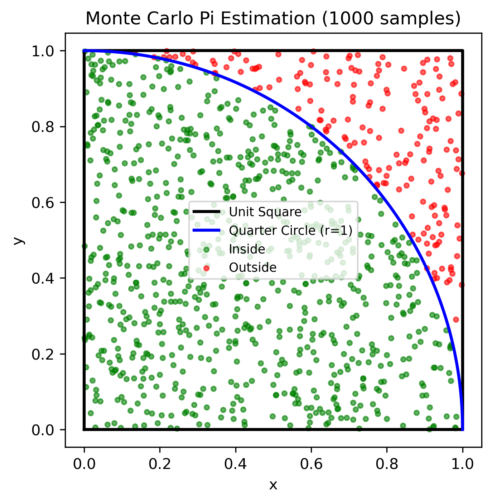

# The Monte Carlo Method: Estimating $\pi$ at Scale

Certain problems in science and engineering are deterministic, meaning we can solve them exactly using algebraic equations.
If you want to know the velocity of a falling object, you apply a formula. However, many systems are far too complex for simple equations.
To solve these problems, we rely on probability.

The Monte Carlo method is a computational technique that uses random sampling to obtain numerical results.
It operates on a simple, profound premise: if you cannot calculate the exact answer, you can simulate a process thousands of times and let the law of averages reveal the truth.

To understand this concept, we will use it to solve a classic problem. We will estimate the value of the mathematical constant $\pi$ by throwing virtual darts at a board.

## The Geometric Intuition

Imagine drawing a perfect square on a piece of paper.
The sides of this square measure exactly one meter.
Inside this square, you draw a quarter of a circle.
The center of the circle sits at the bottom-left corner of the square, and its radius reaches exactly to the edges, giving it a radius of one meter.

If you close your eyes and throw a dart completely randomly at this piece of paper, what is the probability that your dart lands inside the quarter-circle boundary?

The probability is simply the ratio of the two areas.
Because the square has a side length of $1$, its total area is exactly $1$.
The area of a full circle is $\pi r^2$.
Because our radius is $1$, a full circle has an area of $\pi$.
Therefore, our quarter-circle has an area of $\frac{\pi}{4}$.

When we divide the area of the quarter-circle by the area of the square, we find that the probability of a random dart landing inside the curve is exactly $\frac{\pi}{4}$.

$$
\text{Probability} = \frac{\text{Area of quarter circle}}{\text{Area of square}} = \frac{\pi / 4}{1} = \frac{\pi}{4}
$$

If we multiply this probability by four, we isolate $\pi$.
This gives us a mechanism to calculate the constant using nothing but random chance.
If we throw one million random darts and count how many land inside the curve, the ratio of "inside darts" to "total darts" multiplied by four will approximate $\pi$.

### Computational Geometry

Before we throw our virtual darts, we must translate our geometric intuition into a format a computer can understand.
We establish a two-dimensional Cartesian coordinate system.
The bottom-left corner of our square sits at the origin point $(0, 0)$.
The top-right corner sits at $(1, 1)$.

```python
--8<-- "docs/examples/mc-pi/pi_estimator.py:viz_functions"
```

To determine if a random dart lands inside the quarter-circle, we must measure its distance from the origin.
The Pythagorean theorem states that the distance squared from the origin to any point $(x, y)$ is equal to $x^2 + y^2$.
Because our quarter-circle has a radius of exactly $1$, any point whose distance from the origin is less than or equal to $1$ must be inside the circle.

We can define our entire simulation using this single mathematical constraint: if $x^2 + y^2 \leq 1$, the dart is a success.

```python
--8<-- "docs/examples/mc-pi/pi_estimator.py:core_logic"
```

### Worked Example: Tracking the Darts

Let us walk through the algorithm manually with three simulated dart throws to observe how the ratio evolves.

Our first random throw lands at the coordinates $x = 0.2$ and $y = 0.5$.
We square both numbers and add them together.
The sum is $0.29$.
Because $0.29$ is less than $1$, this dart landed inside the quarter-circle.
We have thrown one dart, and one has landed inside.
Our current estimate for $\pi$ is $4 \times (1 / 1)$, which equals $4.0$.

Our second random throw lands near the top right corner at $x = 0.9$ and $y = 0.8$.
We square these numbers and calculate a sum of $1.45$.
Because this value exceeds $1$, the dart missed the circle and landed in the empty corner of the square. We have now thrown two darts, and only one landed inside.
Our estimate for $\pi$ becomes $4 \times (1 / 2)$, which equals $2.0$.

Our third throw lands at $x = 0.5$ and $y = 0.5$.
The squared sum is $0.5$, which places it safely inside the boundary.
With three total darts and two successes, our estimate updates to $4 \times (2 / 3)$, yielding roughly $2.66$.

As we generate more points, the extreme swings in our estimate begin to stabilize.
The ratio slowly converges toward the true value of $3.14159$.



### The Scale of Randomness

The accuracy of a Monte Carlo simulation relies entirely on the volume of data.
Throwing a few thousand darts yields a highly volatile and inaccurate estimate.
To reliably calculate $\pi$ to multiple decimal places, we must generate billions of random coordinates.

Processing one billion geometric calculations sequentially on a single CPU core is agonizingly slow.
However, this specific algorithm exhibits a structural property that makes it trivial to distribute across multiple computers.
Every single dart throw is entirely independent.
The trajectory of the one-millionth dart does not care about the outcome of the very first dart.

Computer scientists refer to this property as an "embarrassingly parallel" workload.
Because no individual calculation depends on the state of any other calculation, we do not need complex communication protocols between our processors.
We can simply split the total number of darts into independent batches and hand them out to a cluster of machines.

### Designing the Distributed Pipeline

To execute this massive computation, we must transition our logic into the **`raygent`** framework.
We begin by wrapping our core sampling algorithm inside an isolated Task.

This Task acts as an independent workstation.
The framework will pass an integer representing the workload&mdash;the number of darts to throw&mdash;into the `do` method.
The workstation will execute the throws, count the successes, and return the result.
By keeping this logic completely self-contained, the framework can effortlessly duplicate this workstation across every available CPU core in the cluster.

```python
--8<-- "docs/examples/mc-pi/pi_estimator.py:raygent_task"
```

With our isolated workstation defined, we must architect the pipeline to deliver the workloads and aggregate the results.
We utilize a Directed Acyclic Graph (DAG) to map the flow of data.

We cannot simply push one billion requests into the network simultaneously.
Doing so would instantly crash the system memory.
Instead, we divide the grand total into manageable chunks based on our hardware.
If we want one billion samples and possess eight workers, we create a list of eight separate workloads, each demanding 125 million samples.

We establish a source queue to ingest this list of workloads.
We connect this source to our pool of Monte Carlo worker nodes.
Finally, we attach a sink queue to the end of the graph to catch the answers.
Once the factory is wired and powered on, the `stream` generator safely pumps the eight workloads into the source queue, waits for the parallel processing to finish, and yields the final counts back to us for the final algebraic calculation.

```python
--8<-- "docs/examples/mc-pi/pi_estimator.py:raygent_execution"
```
